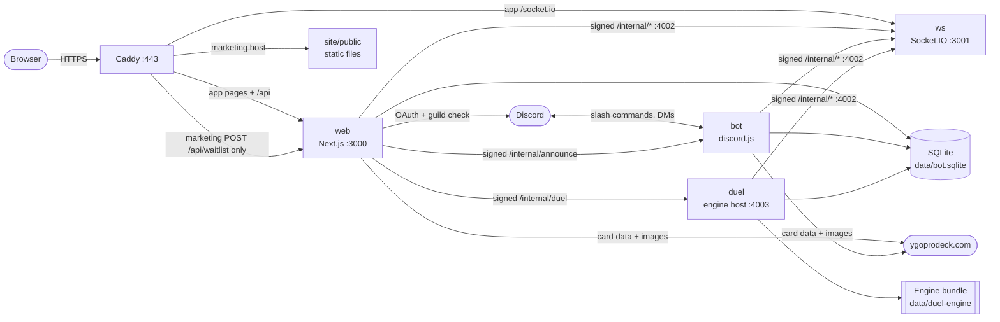
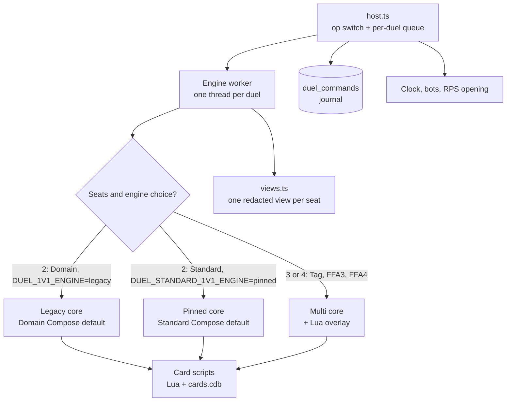
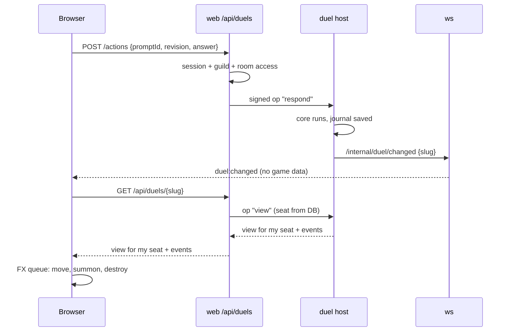
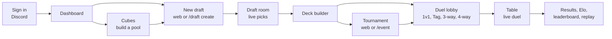

# Architecture

A short map of the system. The code is the source of truth; this page tells you where to look.

## 1. The platform



| Box | Job | Code |
|---|---|---|
| web | Pages, API routes, Discord sign-in | `packages/web` |
| ws | Live pushes only. Never carries hidden game data | `packages/ws` |
| bot | Slash commands, announcements, timers, card sync | `packages/bot` |
| duel | Runs the rules engine. Private, internal port only | `packages/duel-server` |
| shared | DB schema and all business services | `packages/shared` |

All internal calls are HMAC-signed POSTs (`shared/src/notify/signed-post.ts`). Ports 4001, 4002 and 4003 are never public.

`SITE_DOMAIN=app.duelingdomain.com` serves the app. `MARKETING_DOMAIN=duelingdomain.com` serves static files, redirects `/login` to the app, and permits only the exact waitlist POST upstream; its `www` redirects to the marketing apex. `LEGACY_DOMAIN=duelistskingdom.com` and its `www` preserve paths/queries in a 308 to the app. Unset extra domains use reserved `.localhost` defaults for local use. `createWaitlistService(db)` stores unique normalized emails in `waitlist_signups`, independent of guilds. See [domains](deployment/domains.md).

## 2. The duel engine



**One action, start to end**

1. The host checks the `promptId` and `revision`. A stale answer gets 409.
2. The worker feeds the answer to the WASM core.
3. The host appends the command to the journal in SQLite.
4. The host builds a view for each seat. Hidden cards are removed.

**Cores.** Each core has a Standard and a Domain (Deck Master) build.

| Core | Used for | File |
|---|---|---|
| Legacy | Domain 1v1 Compose default (`DUEL_1V1_ENGINE=legacy`); Standard with `DUEL_STANDARD_1V1_ENGINE=legacy` | npm `ocgcore-wasm`, `ocgcore.domain.legacy.wasm` |
| Pinned | Standard 1v1 Compose default (`DUEL_STANDARD_1V1_ENGINE=pinned`); Domain with `DUEL_1V1_ENGINE=pinned` | `ocgcore.standard.wasm`, `ocgcore.domain.wasm` |
| Multi | Tag, 3-way, 4-way | `ocgcore.multi.wasm`, `ocgcore.multi-domain.wasm` |

Native runs with a missing, empty or invalid Standard override use `DUEL_1V1_ENGINE` (default `legacy`).
Compose uses `pinned` for a missing or empty Standard value. Each game of a series reads the switch at its start;
recover and replay keep that game's saved engine. See [the engine switch](deployment/duel-engine-switch.md).

**Engine data.** `scripts/prepare-data.ts` pins the card DB (BabelCDB), strings and Lua scripts (ProjectIgnis CardScripts). `manifest.json` holds the hashes and the `bundleVersion`. The server checks the bundle at start.

**Restart safety.** Live state is in worker memory. SQLite keeps the seed and the command journal. `recover()` replays the journal on a fresh worker. A replay needs the same `bundleVersion`.

## 3. Engine to screen



- The socket only says "something changed". The browser then asks for its own view.
- The seat always comes from the DB. A client cannot act for another seat.
- If the socket is down, the page polls (1 s offline, 10 s live).
- A 5-minute signed token (`/connection`) lets a tab join the duel room.
- FX: `event-queue.ts` → `effect-sequence.ts` → `MoveFx`, `SummonFx`, `DestroyFx`.

## 4. What we added for Tag, 3-way and 4-way

| Layer | Added | Where |
|---|---|---|
| Core | ~91 patches: seat arrays, teams, elimination, team LP, opponent binding, FFA attack rules, clockwise chain order, leaving | `duel-server/domain-core/patches/` |
| Core | Domain multi core: Deck Master for 3 and 4 seats | `build-multi-core.sh`, `apply-domain-multi.mjs` |
| Core | FFA4: across seats (0+2, 1+3) share Extra Monster Zones and columns | patch 0077 |
| Scripts | Lua overlay: ~580 card fixes + `mp-utility.lua`. 1v1 never loads it | `domain-core/multi-scripts/` |
| Host | Formats, seat counts, teams, opponents | `shared/src/duels/settings.ts` |
| Host | Seat lobby, practice bots, ready, start | `shared/src/services/duels.ts` |
| Host | Attack-target pick, surrender, timeouts, autopilot for out seats | `attack-target-pick.ts`, `host.ts` |
| Host | Flag `MULTIPLAYER_TABLES` (Compose: on) | `shared/src/duels/multiplayer-tables.ts` |
| Rules | Rule list and tests | `docs/adr/0002`, `docs/specs/multiplayer-rule-coverage.md` |
| UI | 3-way and 4-way: Plaza table, aim arrow, seat crumble | `web/src/components/duel/table/` |
| UI | 4-way 2x2 grid and the FFA3 facing pair (seats 0+1 share one Extra Monster Zone row; seat 2 has its own). A seat that is out crumbles and its place stays empty; fields never move or join and the camera never zooms by itself. No "choose an opponent" UI | `web/src/components/duel/table/grid-stage.tsx`, `grid-layout.ts` |
| UI | Tag 2v2: Rooftop, shared team LP | `web/src/components/duel/tag/` |

Not on main yet: the 4-way 2x2 grid UI, and PR #178, which changes the FFA4 shared zones from across seats (0+2, 1+3, patch 0077) to facing seats (0+1, 2+3).

## 5. How a player uses the site



## More

- Rules for multiplayer: [ADR 0002](adr/0002-multiplayer-duel-rules.md). Test layers: [ADR 0003](adr/0003-duel-test-layers.md).
- Draft dealing: [draft-engine.md](draft-engine.md). Core ABI: [engine/ocgcore-wasm-abi.md](engine/ocgcore-wasm-abi.md).
- Deploy and ops: [deployment/vm-runbook.md](deployment/vm-runbook.md), [deployment/duel-engine-switch.md](deployment/duel-engine-switch.md).
- Weekly card data updates: [deployment/engine-data-updates.md](deployment/engine-data-updates.md).

## Card artwork selection

The duel server owns selectable artwork identity: only passcodes in its `cards.cdb` artwork alias family may enter a deck picker. The authenticated web artwork route merges that family with `card_artworks` API metadata and the existing image cache, returning only local cached-image route URLs (nullable when availability is unknown). Search stays one result per card and includes `altArtCount`. Deck storage preserves selected engine passcodes; draft-pool checks canonicalize both sides without rewriting the art choice. Explicit cube rows can swap same-family artwork while retaining copy counts.

See [the picker backend contract](specs/alt-art-picker.md) for exact routes, types, alias edge cases, and the resumable `npm run backfill:artworks --workspace=packages/shared -- --database … --dump … --state …` maintenance command. The backfill downloads one full metadata dump, syncs existing catalog families, and does not fetch images. It must be run explicitly; no production backfill is part of this implementation.

## Stored duel boards

Sandbox rows remain excluded from ordinary duel lists. Storage maintenance can backfill and compress terminal sandbox rows through the same codec. It preserves their setup, seed, deck, and command data. Active sandbox rows are not changed; cancelled sandbox play rows are not deleted.

Terminal duels keep the public final board and each seat's own final board. All server readers use `services/stored-duel-snapshots.ts`. Each snapshot column can hold old JSON TEXT or gzip BLOB bytes. SQLite permits BLOB values in the existing TEXT-affinity columns. The codec accepts both forms. No board, event, or log data is removed. Finished-room history and last-damage displays still read `events`; bug context uses only the public board's last log lines.

New writes use JSON. A complete `snapshot_seats_json` list supersedes the two legacy seat columns for FFA3, FFA4, and Tag. Those new rows leave `snapshot_seat0_json` and `snapshot_seat1_json` null. Incomplete lists retain legacy seat columns. Two-seat final writes retain their existing three columns. The nullable `turn_count` column records the final turn. Active casual cancellation saves the live turn, falling back to the saved clock before clearing it. History reads this column with a bounded metadata-prefix fallback for old JSON rows until the age-independent turn backfill reaches them. The backfill runs even while compression is disabled.

The duel host runs snapshot retention separately from its frequent archive sweep. Its first pass starts after one minute. Later passes use these settings. Local Compose values are not added by this port:

| Variable | Default | Effect |
| --- | --- | --- |
| `DUEL_SNAPSHOT_RETENTION_ENABLED` | `0` | `1` or `true` enables compression and cancelled-fork deletion. Turn-only backfill still runs while disabled. Checked between rows and before writes. |
| `DUEL_TURN_BACKFILL_ENABLED` | `1` | `1` or `true` enables turn-only backfill, independently of retention. Checked between rows and before writes. Set both switches to `0` to stop storage maintenance writes. The coordinator supplies deployment settings. |
| `DUEL_SNAPSHOT_RETENTION_DAYS` | `30` | Compress terminal boards after this many days from `ended_at`. Nonnegative integer. |
| `DUEL_SNAPSHOT_RETENTION_INTERVAL_MS` | `21600000` | Time between passes (6 hours). Minimum 60000; maximum 2147483647. |

A pass first backfills terminal turn counts without an age limit when its switch is on, even when retention is off. It writes only the count and skips rows with no snapshot or clock. The host retains the ID cursor across passes, advances past unreadable turns, and resets it only after a select finds no rows. After a scan wraps, the host waits at least one hour before a new full turn scan. Compaction and fork cleanup continue during this delay. A busy read or write leaves its row for the next pass. History scans a bounded JSON prefix until the backfill reaches a row; SQLite `substr()` still reads the full TEXT value, including overflow pages. Once `turn_count` is set, `coalesce` skips this read. Compaction selects IDs and fetches one full row at a time within its byte budget. A pass prepares gzip data outside its write transactions. It yields between rows, caps an update batch at 50 rows and 4 MiB of input bytes (one larger row can proceed alone), and waits 100 ms between batches. A pass processes at most 20 update batches. Maintenance writes use zero busy timeout; a held lock defers work to the next pass. The connection's normal timeout is restored in `finally`. Conditional updates check the original board bytes and terminal metadata to protect concurrent changes.

`snapshot_compacted_at` marks processed rows, including rows with unreadable values. The job preserves unreadable bytes and can derive turns from other saved views or the old clock. This stamp makes each pass resumable and avoids repeated work. After an operator repairs a stored value, clear its stamp to process it again. Migration adds columns and indexes; it does not backfill counts, compress boards, or remove duplicate values during service startup.

For old multiplayer rows, a complete valid seat list supersedes the legacy seat copies, even if those copies differ. All readers already select the list first. Only then does the job null the copies. Gzip preserves the original JSON bytes. Replay cache keys hash stored bytes with encoding tags: compression, deduplication, or a board change invalidates the cache. Room, admin reveal, replay result, saved-board fallback (413 or unavailable source engine), and bug-context reads all use the same codec.

Each pass can delete at most 50 replay forks that are cancelled and ended more than 7 days ago. Deletion skips forks with queued host work, including asynchronous restart preparation and creator launch-retry queues. Each phase logs and isolates row failures. Error logs include only the phase, error name and code. Pass statistics expose progress and busy deferrals. `turnBackfillDone` means the cursor reached the end of its scan, or the backfill is disabled. Unreadable turns remain null and can be retried on the next scan. `backlogDone` includes this flag and the enabled compaction and fork phases; the host logs backfill progress and completion even while retention is off. It requires enabled foreign keys and no series link; the final DELETE rechecks these row guards. Each fork gets a separate transaction and a yield. Commands, seats, invite grants, and retry records cascade through indexed foreign keys. Fork source references are copied metadata or strings; the source is preserved. Active, completed, and interrupted forks are kept. Restart clears the count and compaction stamp. The host permits one pass at a time and waits for it at shutdown.

Compression frees SQLite pages for reuse. It does not shrink the database file. See the [manual VACUUM procedure](deployment/vm-runbook.md#manual-duel-storage-vacuum) to return space to the file system. Retention defaults off for this release. Keep it off until all snapshot-reading services use the codec and a stable codec release is available for rollback, then enable it and recreate the duel container. After retention has run, roll back only to a release that has the codec. Older saved-board readers show no final board and no history turn count for compressed rows, and the old eliminated-spectator reader can return HTTP 500 on gzip BLOBs.

To repeat the synthetic measurement with Node 22 and dependencies installed:

```bash
prlimit --core=0 node --import tsx scripts/measure-duel-storage.ts
```

The fixture uses 40 synthetic card definitions, final public and own-seat projections, and bounded event/log histories. It contains no production data. Its repeating text compresses well; these figures are test measurements, not production estimates. Before means all old snapshot columns; after means deduplication plus gzip. Bytes exclude SQLite page and journal overhead.

| Format | Before bytes | After dedup bytes | After gzip bytes | Saved | Public-board events | Public-board log |
| --- | ---: | ---: | ---: | ---: | ---: | ---: |
| 1v1 | 305609 | 305609 | 14222 | 95.35% | 65.81% | 16.85% |
| FFA3 | 1093385 | 727715 | 30086 | 97.25% | 73.10% | 12.50% |
| FFA4 | 1947937 | 1390353 | 50884 | 97.39% | 79.37% | 8.14% |
| Tag | 1030265 | 734873 | 31839 | 96.91% | 60.60% | 15.55% |

Gzip bytes are 4.65%, 4.13%, 3.66%, and 4.33% of deduped JSON bytes, respectively. Keep events: the final-board UI uses them. The measurement script is separate from retention and never opens the database.
