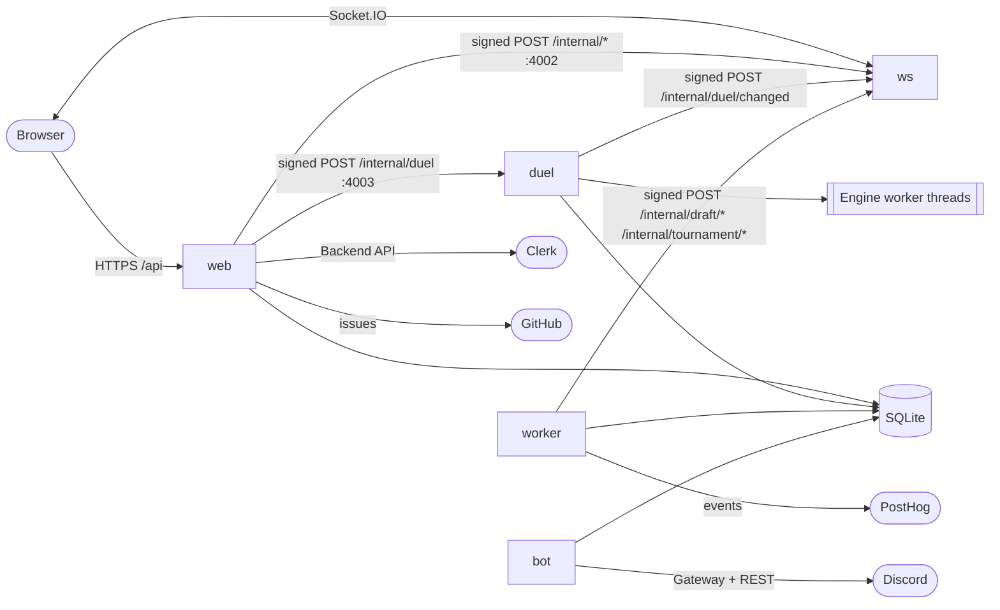
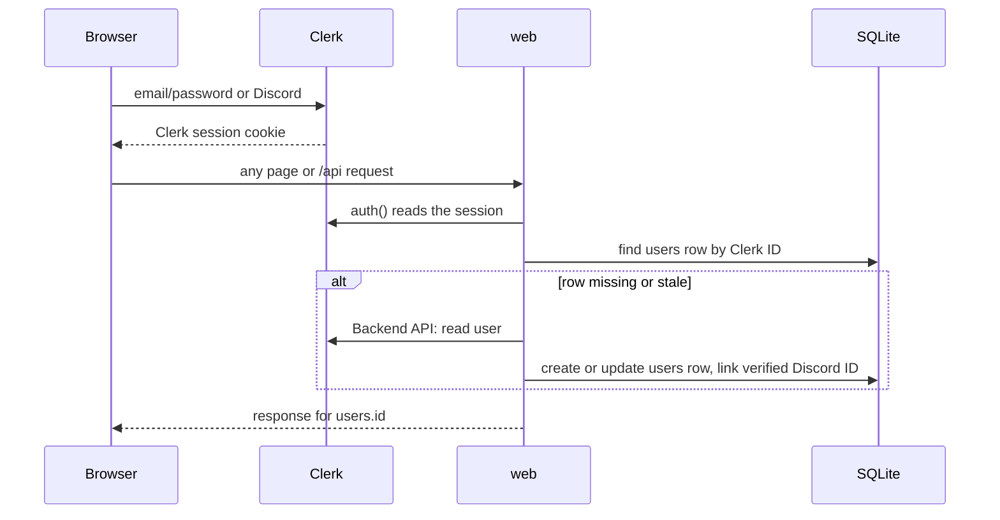
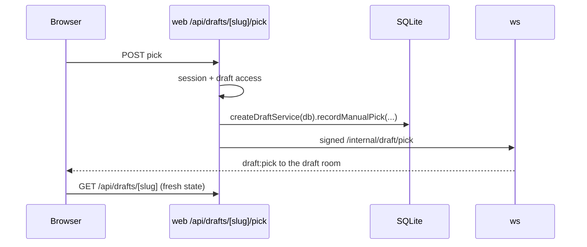
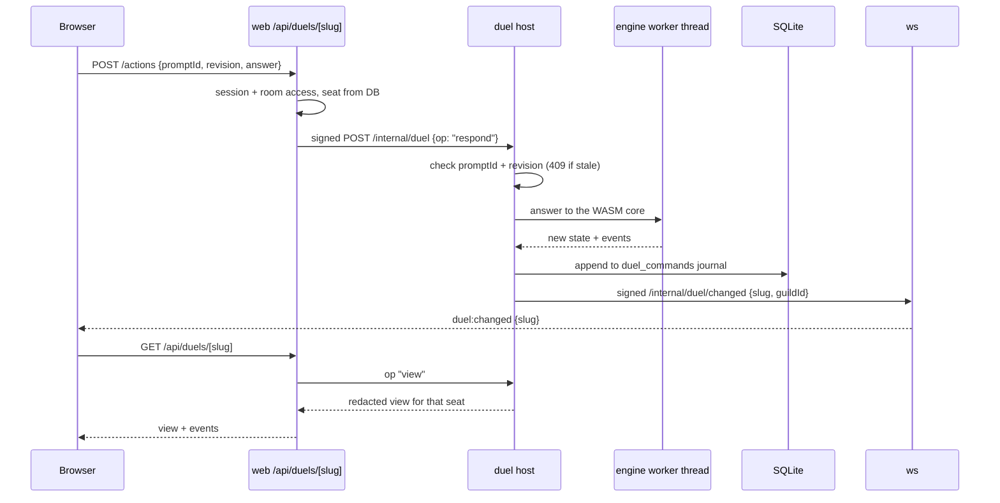
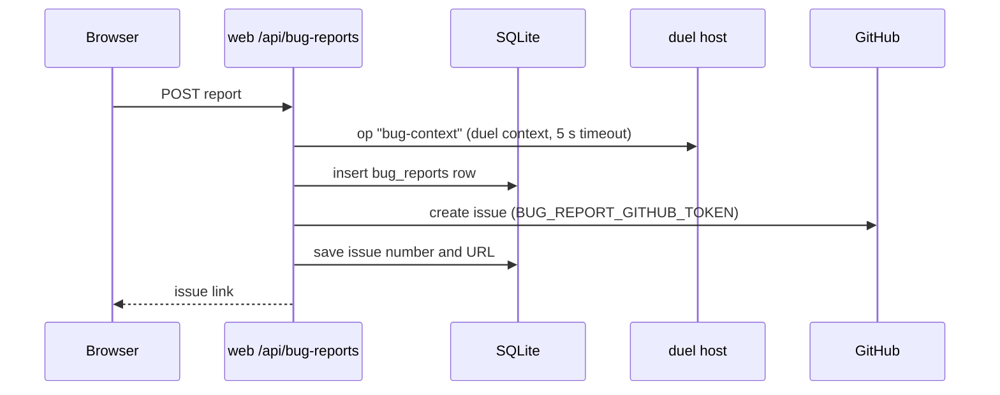

# Data flow

This page shows how data moves between the browser, the services and SQLite. For the package map, see the [architecture overview](README.md). For hosts and containers, see [infrastructure](infrastructure.md).

## Rules that apply to every path

| Rule | Where in code |
|---|---|
| SQLite is the only durable store. web, duel, worker and bot open the same file (`DATABASE_PATH`). ws opens it only for its health row. | `packages/shared/src/db/`, `packages/ws/src/server.ts` |
| Business rules live in shared services (`createDraftService(db)` and others). Every writer calls them. | `packages/shared/src/services/` |
| The browser talks only to web (HTTPS) and ws (Socket.IO). It never reaches duel, worker or bot. | `Caddyfile` |
| ws carries "something changed" signals and small public events. It never carries hidden game data. | `packages/ws/src/internal-http.ts` |
| Service-to-service calls are signed HTTP POSTs (see [Signed internal HTTP](#signed-internal-http)). | `packages/shared/src/internal-auth/` |
| Every API route resolves the session first. No session gives 401. A failed check gives 503. | `packages/web/src/lib/session-identity.ts`, `web-access.ts` |

## Overview

## Signed internal HTTP

All internal calls use one v2 HMAC scheme in `packages/shared/src/internal-auth/request.ts`.

| Item | Value |
|---|---|
| Header | `x-internal-signature: t=<unix seconds>,v2=<hex>` |
| Signed text | `v2`, method, path and query, timestamp, then the raw body |
| Key | HMAC-SHA256 of the shared secret with `yugidraft:<purpose>:v2` (`keys.ts`). One secret gives a different key per purpose. |
| Purposes | `ws-broadcast` (to ws), `duel-host` (to duel), `bot-announce` (legacy, no listener now) |
| Clock window | The receiver refuses a timestamp more than 60 seconds away from its clock (401). |
| Body limit | 64 KiB by default (413). The receiver checks the raw bytes before it parses JSON. |

| Caller | Receiver | Port | Secret | Paths |
|---|---|---|---|---|
| web, worker | ws | 4002 | `WS_INTERNAL_SECRET` | `/internal/draft/{status,pick,resync,complete,seats,talk}`, `/internal/tournament/{participant-joined,participant-left,started,cancelled,completed,match-updated}` |
| web, duel | ws | 4002 | `WS_INTERNAL_SECRET` | `/internal/duel/changed` |
| web | duel | 4003 | `DUEL_INTERNAL_SECRET` | `/internal/duel` (one path; the body names the `op`) |

The web side of the duel call is `packages/web/src/lib/duel-host.ts`. A wrong secret gives a clear error that names `DUEL_INTERNAL_SECRET`.

## Socket room tokens

A browser must hold a short signed token to join a Socket.IO room. web signs it with `WS_INTERNAL_SECRET` (purpose-derived key). ws verifies it (`packages/shared/src/internal-auth/token.ts`).

| Room | Token route | Claims | Life |
|---|---|---|---|
| Draft | `GET /api/drafts/[slug]/connection` | `slug`, `guildId`, `userId`, `expiresAt` | 60 s (`DRAFT_ROOM_TOKEN_TTL_MS`) |
| Tournament | tournament connection route | `slug`, `guildId`, `userId`, `expiresAt` | 60 s (`TOURNAMENT_ROOM_TOKEN_TTL_MS`) |
| Duel | `GET /api/duels/[slug]/connection` | `slug`, `guildId`, `playerId`, `seat`, `expiresAt` | 5 min (`DUEL_CONNECTION_TTL_MS`) |
| Admin spectate | `/api/admin/{duels,drafts}/[slug]/spectate/connection` | kind, `slug`, `userId`, `expiresAt` | 60 s (`ADMIN_SPECTATE_TTL_MS`) |

Duel tokens use the gameplay `playerId`. The other tokens use the application `users.id`. ws sends `*:subscription-expired` when a token runs out, and the page asks for a new one.

## Sign-in

- One resolver: `resolveSessionIdentity()` in `packages/web/src/lib/session-identity.ts`. Profile sync is in `clerk-sync.ts`.
- `users.id` is the application identity. `players.user_id` links gameplay players to it.
- The isolated e2e stack uses a signed `dd_e2e_session` cookie instead of Clerk.
- `POST /api/webhooks/clerk` takes Clerk events (Svix signature, `CLERK_WEBHOOK_SIGNING_SECRET`). It bypasses the session check.

## Draft pick

- web sends the broadcast after the service call returns (`broadcaster` in `packages/web/src/lib/notify.ts`).
- Test bots pick through the same route after each human pick.
- Pick deadlines: the worker runs `draftTimer.tick()` every second. It expires late steps and broadcasts through ws.

## Duel action

- The seat always comes from the DB, never from the client.
- If the socket is down, the page polls.
- ws also tracks presence (`duel:presence`): which seats have a visible tab.

## Engine workers

| Item | Value | Code |
|---|---|---|
| Thread model | One Node worker thread per live game | `packages/duel-server/src/worker-client.ts` |
| Limit | `DUEL_MAX_WORKERS` (default 12). `DUEL_MAX_TABLES_PER_PLAYER` (default 3) | `config.ts`, `worker-pool.ts` |
| Idle thread | Closed after `DUEL_IDLE_WORKER_MS` (Compose 300000) | `server.ts` |
| Heap | `DUEL_WORKER_HEAP_MB` (Compose 256) | `docker-compose.yml` |
| Core choice | 2 seats: legacy or pinned core. 3 or 4 seats: multi core | [overview, section 2](README.md#2-the-duel-engine) |
| Restart | Live state is in thread memory. `recover()` replays the journal from SQLite on a fresh thread | `host.ts` |
| Views | `views.ts` builds one view per seat and removes hidden cards | `views.ts` |

The engine files (WASM cores, `cards.cdb`, Lua scripts) come from `DUEL_DATA_DIR`. See [core pins](../engine/core-pins.md).

## Worker jobs

The worker has no inbound port. It reads and writes SQLite and posts to ws. Source: `packages/worker/src/index.ts`.

| Job | Interval | Effect |
|---|---|---|
| Draft timer | 1 s | Expires late pick steps, broadcasts draft events |
| Tournament timer | 60 s | Round and match deadlines, broadcasts tournament events |
| Product events drain | 10 s | Sends `product_events` rows to PostHog |
| Heartbeat | 30 s | Writes `worker_heartbeat` for `/admin` |
| Presence cleanup | 10 min | Removes presence rows with no update for 24 h |
| VPS health, disk usage | own loops | Stores snapshots that `/admin` reads |
| Set sync | `SETS_SYNC_CRON` (default `0 6 * * *` UTC) | Card sets from ygoprodeck.com |
| Genesys points sync | `GENESYS_SYNC_CRON` | Genesys points list ([details](card-data/genesys-points.md)) |
| Image cleanup | `IMAGE_CLEANUP_CRON` (default `0 4 * * *` UTC) | Removes oldest cached images over `CARD_IMAGE_CACHE_MAX_BYTES` |

Compose sets `DISCORD_BOT_ENABLED=0` on the worker. So it sends no gameplay Discord messages. See also [worker timers](../runbooks/worker-timers.md) and [worker syncs](../runbooks/worker-syncs.md).

## Outboxes

Two tables hold work that another process sends later. The writer commits the row in the same transaction as its change.

| Outbox | Writer | Sender | Target |
|---|---|---|---|
| `discord_outbox` | web (waitlist alerts, decisions), bot (mod logs) through `enqueueOutbox()` and `recordModAction()` | bot poller every 3 s, one row per claim, 60 s lease | Discord REST |
| `product_events` | web (sign-in) and shared services (duels, waitlist) through `recordProductEvent()` | worker drain every 10 s | PostHog |

- Discord outbox code: `packages/shared/src/discord-admin/outbox.ts`, `packages/bot/src/runtime/outbox.ts`. web writes only when `DISCORD_ADMIN_OUTBOX_ENABLED=1`.
- Analytics code: `packages/shared/src/analytics/record.ts`, `packages/worker/src/analytics-drain.ts`.

## Bug report

- Without `BUG_REPORT_GITHUB_TOKEN`, the report is only saved in SQLite.
- `POST /api/bug-reports/precheck` checks for an open duplicate first.
- Code: `packages/web/src/lib/bug-report-github.ts`, `packages/web/src/lib/bug-reports/server-context.ts`.

## Admin bot

The bot is a Discord Gateway client with no inbound HTTP port ([ADR 0006](../adr/0006-admin-discord-bot.md)). It reads `users.discord_user_id` to map Discord members to site accounts, writes audit rows, and sends the Discord outbox. Only literal `DISCORD_BOT_ENABLED=1` makes it open SQLite. See [Discord bot setup](../deployment/discord-bot.md).
