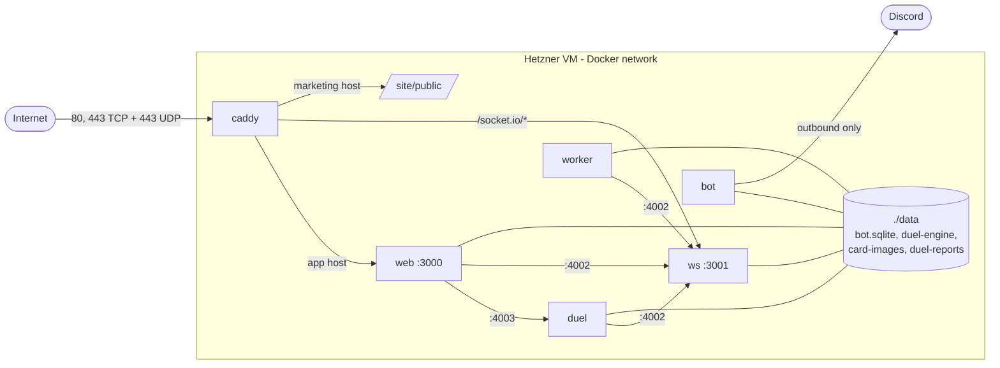
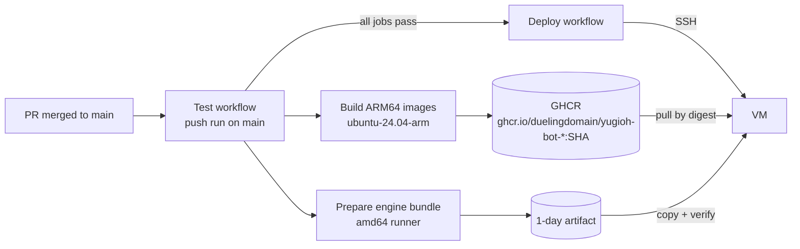

# Infrastructure

This page tells what the system runs on and how a release gets to the server. For the step-by-step operations, use the [VM runbook](../deployment/vm-runbook.md) and the [runbooks](../runbooks/README.md). For data paths between services, see [data flow](data-flow.md).

## Summary

| Part | What | Source of truth |
|---|---|---|
| Server | One Hetzner Cloud CAX11 VM: ARM64, 4 GB RAM, Ubuntu 24.04, Nuremberg | [vm-runbook](../deployment/vm-runbook.md#vm-setup-hetzner-cax11-or-similar), [domains](../deployment/domains.md) |
| App path | `/opt/yugioh-bot` on the VM | [vm-runbook](../deployment/vm-runbook.md#current-repository-state) |
| Runtime | Docker Compose, one container per service | `docker-compose.yml` |
| Edge | Caddy 2.11 with automatic HTTPS | `Caddyfile` |
| Images | ARM64 images built in GitHub Actions, pushed to GHCR | `.github/workflows/test.yml`, `deploy.yml` |
| Database | One SQLite file, `data/bot.sqlite` | `packages/shared/src/db/` |
| Backups | Daily SQLite snapshot on the VM | [vm-backup runbook](../runbooks/vm-backup.md) |
| External services | Clerk (sign-in), Sentry (errors), PostHog (analytics), GitHub (bug report issues), Discord (admin bot, alerts), ygoprodeck.com (card data and images) | `docker-compose.yml` env |

## Why one small VM

- The app needs long-lived processes: Socket.IO connections, engine worker threads with game state in memory, a Discord Gateway client and timers. Serverless functions and hosts that sleep do not fit.
- SQLite needs one persistent disk that all services share. Ephemeral container storage does not work.
- A CAX11 is cheap (about EUR 3.79 a month) and has enough memory for the Compose memory limits below.
- Run only one copy of each writer. Two workers or two bots on the same SQLite file would run jobs twice.

## Compose services

| Service | Image | Ports (Docker network only) | Memory limit | Notes |
|---|---|---|---|---|
| `ws` | `yugioh-bot-ws` | 3001 public via Caddy, 4002 internal | `WS_MEM_LIMIT` (384m) | Opens SQLite only for its health row |
| `duel` | `yugioh-bot-duel` (target `duel-bundled`) | 4003 internal | `DUEL_MEM_LIMIT` (1g) | Engine bundle from `data/duel-engine`. Health: `GET /healthz`. Start period 5 min |
| `web` | `yugioh-bot-web` | 3000 via Caddy | none set | Next.js. Starts after ws and duel |
| `worker` | `yugioh-bot-worker` | none | 384m, heap 256 MB | Timers and cron jobs. Stop grace 150 s |
| `bot` | `yugioh-bot-bot` | none | 256m, heap 160 MB | Idle unless `DISCORD_BOT_ENABLED=1`. Stop grace 45 s |
| `caddy` | `caddy:2.11.2-alpine` | publishes 80, 443, 443/udp | none set | Mounts `Caddyfile` and `site/public` read-only |

Every app container:

- runs as user `node` (uid 1000) from `node:22-bookworm-slim` (see `Dockerfile`);
- has `cap_drop: [ALL]`, `no-new-privileges` and `restart: unless-stopped`;
- mounts `./data` at `/app/data`.

Caddy keeps only `NET_BIND_SERVICE`. Ports 4002 and 4003 are never published. The cloud firewall allows TCP 22, 80, 443 and UDP 443 only.

`docker-compose.override.yml` is for local development. Production runs `docker compose -f docker-compose.yml` without it.

## Caddy hosts

| Variable | Production host | Routes |
|---|---|---|
| `SITE_DOMAIN` | `app.duelingdomain.com` | `/socket.io/*` to `ws:3001`; `/ingest/*` to PostHog EU; all else to `web:3000` (30 s retry during a web restart). `noindex` header, CSP in report-only mode |
| `MARKETING_DOMAIN` | `duelingdomain.com` | Static files from `site/public`; only `POST /api/waitlist` goes to web; `/login` redirects to the app; a signed-in member's home GET gets a 302 to the app |
| `LEGACY_DOMAIN` | `duelistskingdom.com` | 308 to the app host with path and query |
| `www.` of each | - | 308 to the bare host (legacy: to the app) |

Empty extra domains fall back to reserved `.localhost` names, so Caddy asks for no public certificate. After a `Caddyfile` change, recreate the `caddy` container; `restart` does not reload the bind mount. Details: [domains](../deployment/domains.md).

## Data directory

All state is under `/opt/yugioh-bot/data` on the VM (`/app/data` in containers).

| Path | Owner | Contents |
|---|---|---|
| `bot.sqlite` (+ `-wal`, `-shm`) | web, duel, worker, bot | All application data. WAL mode, 5 s busy timeout |
| `duel-engine/` | duel (read), web (read) | Engine bundle: WASM cores, `cards.cdb`, Lua scripts, `manifest.json` |
| `card-images/` | web (write), worker (cleanup) | Card image cache, capped by `CARD_IMAGE_CACHE_MAX_BYTES` (15 GiB) |
| `duel-reports/` | duel | Engine report files (`DUEL_REPORT_DIR`) |
| `backups/` | worker (size only) | Measured for the `/admin` disk view |

The VM `.env` in `/opt/yugioh-bot` holds runtime secrets and settings. Compose reads it for interpolation. Main secret names: `WS_INTERNAL_SECRET`, `DUEL_INTERNAL_SECRET`, `CLERK_SECRET_KEY`, `CLERK_WEBHOOK_SIGNING_SECRET`, `DISCORD_TOKEN`, `BUG_REPORT_GITHUB_TOKEN`, `SENTRY_DSN`, `ANTHROPIC_API_KEY`. Never print the file. See [Create .env](../deployment/vm-runbook.md#create-env).

## Release path

1. A push to `main` runs **Test**. It prepares the engine bundle and builds the `duel-bundled`, `web`, `bot`, `worker` and `ws` images for `linux/arm64`. Images go to `ghcr.io/duelingdomain/yugioh-bot-<service>:<full SHA>`.
2. **Deploy** starts only after a successful push Test run on `main`. It deploys that run's SHA, never a later tip.
3. Deploy waits for live duels and active drafts, runs the engine preflight on the VM, pulls the images by digest, takes backups, checks activity again, recreates the containers and runs health checks.
4. After the health checks pass, the `production` tag moves to the new digest. The old one becomes `production-prev`.
5. Nothing compiles on the VM. Images and the engine bundle come from Actions.

Rollback and manual runs: Actions, **Deploy**, Run workflow. See [deploy runbook](../runbooks/deploy.md), [image rollback](../deployment/vm-runbook.md#image-rollback) and [GHCR retention](../deployment/vm-runbook.md#ghcr-owner-setup-and-retention). The weekly GHCR cleanup is in [ghcr-cleanup](../runbooks/ghcr-cleanup.md).

GitHub Actions needs `VM_HOST`, `VM_USER`, `VM_SSH_PRIVATE_KEY`, `VM_PORT` and the variable `NEXT_PUBLIC_CLERK_PUBLISHABLE_KEY`. See [GitHub Actions secrets](../deployment/vm-runbook.md#github-actions-secrets).

## Engine bundle

The duel image carries the bundle in `/opt/duel-engine`. Deploy also installs the same bundle into `data/duel-engine` on the host. At start, `install-engine-bundle.sh` checks the volume. A bundle change waits for active duels to finish. Pins and hashes: [core pins](../engine/core-pins.md). Engine choice per table: [engine switch](../deployment/duel-engine-switch.md). Weekly card data: [engine data updates](../deployment/engine-data-updates.md).

## Backups

| Item | Value |
|---|---|
| Unit | systemd `dueling-backup.timer`, runs `scripts/backup/dueling-backup` as root |
| Time | Daily 07:30 UTC, up to 10 min random delay, catches up after downtime |
| Method | Python SQLite backup API (includes committed WAL writes, no stop) |
| Location | `/var/backups/yugioh-bot`, mode 0600 files with SHA-256 sidecars |
| Retention | 7 newest snapshots (`DUELING_BACKUP_KEEP`), none older than 14 days |
| Deploy copies | Release directories keep database copies for 14 days |

Backups stay on the same VM. Restore steps: [vm-runbook Backups](../deployment/vm-runbook.md#backups) and [vm-backup runbook](../runbooks/vm-backup.md).

## Local development

- Native: run each service with `npm run dev:*` (see `CLAUDE.md`). Set an absolute `DATABASE_PATH` for every process.
- Docker: `docker compose up -d --build` uses the override file for hot reload and exposes web and ws on 3000 and 3001.
- E2E: `packages/e2e` starts an isolated stack on the 3300 port family with its own SQLite file. See `packages/e2e/README.md`.
