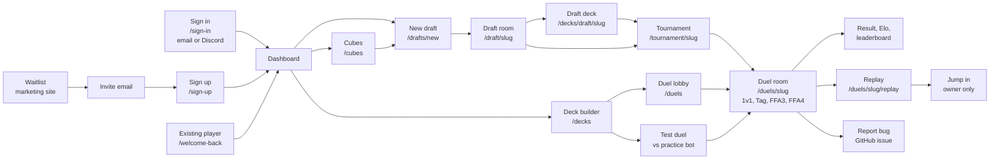

# User flows

These pages tell how a player goes through the web app. Each page gives the entry URL, the steps, what the player sees, and the API routes and services that run. For how data moves between the services, read [architecture/data-flow.md](../architecture/data-flow.md).

Pages live in `packages/web/app/(app)` (signed-in) and `packages/web/app/(auth)` (sign-in). API routes live in `packages/web/app/api`. Shared logic lives in `packages/shared/src/services`.

## Map

## Pages

| Page | Flow |
| --- | --- |
| [sign-in-and-access.md](sign-in-and-access.md) | Waitlist, invite, Clerk sign-in with email or Discord, existing-player recovery, account page, access errors |
| [decks.md](decks.md) | Deck library, deck editor, imports, alternate art, Genesys points, suggestions, test duel |
| [cubes-and-drafts.md](cubes-and-drafts.md) | Cube library and editor, list import, booster and theme drafts, lobby, draft room, cancel rule, test bots |
| [duels-and-tables.md](duels-and-tables.md) | Create a table, formats, openings, the duel room, active-game guard, clocks, idle close, results and Elo |
| [replays.md](replays.md) | Replay viewer, seat views, cross-version check, Jump in (replay fork) |
| [tournaments.md](tournaments.md) | Create, invite link, deck registration, rounds, series, results |
| [bug-reports.md](bug-reports.md) | Report bug button, what is saved, GitHub issue, triage |
| [owner-admin.md](owner-admin.md) | `/admin` console, live watch, card-data page, bug report pages, owner CLI |

## Main navigation

The sidebar items come from `packages/web/src/lib/nav-items.ts`. `packages/web/src/components/layout/shell-model.ts` hides the Admin group unless the person is an owner.

| Item | URL | Who |
| --- | --- | --- |
| Dashboard | `/dashboard` | Signed-in player |
| Tournaments | `/tournaments` | Signed-in player |
| Drafts | `/drafts` | Signed-in player |
| Duels | `/duels` | Signed-in player |
| Decks | `/decks` | Signed-in player |
| Cubes | `/cubes` | Signed-in player |
| Leaderboard | `/leaderboard` | Signed-in player |
| Admin console | `/admin` | Owner (`OWNER_USER_IDS`) |
| Card data | `/settings/card-data` | Owner |
| Bug reports | `/settings/bug-reports` | Owner |
| Account | `/settings/account` | Signed-in player |

Other pages: `/player/[id]` (player profile), `/tournament/[slug]/standings` (redirects to `?tab=standings`), `/themes` and `/themes/[id]` (redirect to `/cubes`).

## Rules that apply on every page

- `packages/web/proxy.ts` runs Clerk on every route. A page without a session goes to `/sign-in?redirect_url=...`. An API route without a session answers 401.
- Identity is the application `users.id`, not the Clerk ID and not a Discord ID (`packages/web/src/lib/session-identity.ts`). See [ADR 0004](../adr/0004-alpha-access-clerk.md).
- All data is scoped to one community: the `DISCORD_GUILD_ID` value. A player row (`players`) is made on first use in that community.
- Live updates come through Socket.IO. The page gets a short-lived token from a `/connection` route, joins a room, and refetches when an event arrives.
- While a game is in progress, other app pages send the player back to the game room. See [duels-and-tables.md](duels-and-tables.md#active-game-guard).
